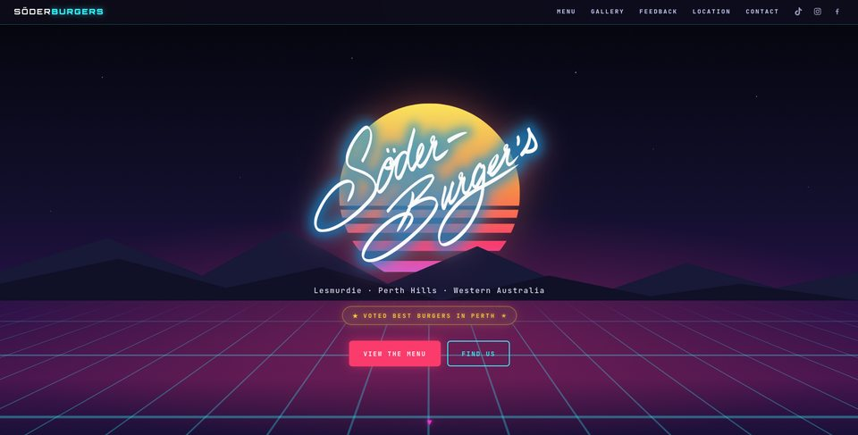
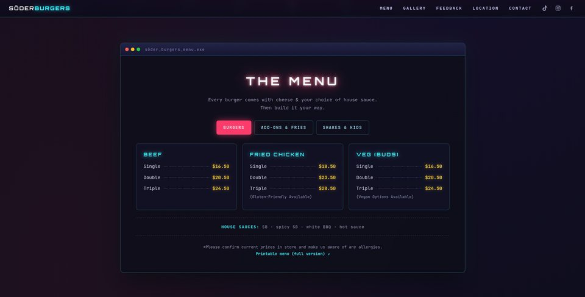

<p align="center">
  
</p>

<h1 align="center">Söder Burgers</h1>

Single-page, Vaporwave themed business website for a Perth-based family burger joint. Built with plain HTML and CSS.

[](LICENSE)

Built by [DeSynkro](https://desynkro.com) for Söder Burgers.

I always open-source my work as a way to give back to the community, thank you to everyone who was welcoming and kind 🥰️

## Requirements

- [Docker](https://docs.docker.com/engine/install/) with the Compose plugin

(or any static file server, the site is plain HTML/CSS with nothing to build)

## Quick start

```bash
git clone <repo-url>
cd soder-burgers-website
docker compose up -d
```

Open [http://localhost:8080](http://localhost:8080)

## Screenshots




## Structure

```
soder-burgers/
├── index.html           # the entire site, single page
├── css/
│   └── style.css        # all styling and interactivity (no JS anywhere)
├── assets/
│   ├── favicon.svg
│   ├── logo.png         # hero logo
│   ├── menu.png         # printable full menu
│   └── gallery/         # optimised WebP + JPEG photos (<picture> sources)
└── docker-compose.yml   # nginx:alpine local preview on :8080
```

## About

Söder Burgers is one of my favorite burger spots in Perth WA and the owner is a good friend of mine. His old site wasn't very polished so I offered to make him a new one as a gift, free of charge.
This is a fun and maintainable upgrade. One HTML file, one stylesheet, and absolutely zero JavaScript. 

Söder Burgers is a small family-run burger joint in Lesmurdie, Perth, Western Australia.

The design leans into an 80s vaporwave aesthetic. Neon sun over a perspective grid, CRT scanlines, and sections framed as retro desktop windows with titles like `söder_burgers_menu.exe` and `feedback.log`, while staying subtle enough for an actual restaurant.

## Features

- **Zero JavaScript**: the hamburger menu is a checkbox, the menu tabs are radio buttons, smooth scrolling is one CSS line
- **Interactive menu**: Burgers / Sides / Shakes & Kids tabs via radio inputs, plus a printable full-menu PNG fallback
- **Gallery**: six lazy-loaded `<picture>` elements serving WebP with JPEG fallback (~480 KB total for all photos)
- **Google reviews**: real review quotes plus a leave-a-review call-to-action linked to their Business Profile
- **Contact cards**: call, email or Instagram, no forms
- **Location**: embedded Google Map tinted dark with a CSS filter
- **Fully responsive**: from phones through to widescreen desktops

## Tech Stack

- HTML5 + modern CSS3, no frameworks or preprocessors
- Google Fonts: [Orbitron](https://fonts.google.com/specimen/Orbitron) & [JetBrains Mono](https://fonts.google.com/specimen/JetBrains+Mono)
- Images optimised offline with Python/Pillow (WebP q78 + JPEG fallback pipeline)

## License

The code is released under the [MIT License](LICENSE).

Site content, branding, business name, logo and menu remain © Söder Burgers and are not covered by the code license.

Photography: the first two gallery shots © DeSynkro, all rights reserved. Remaining shots courtesy of Söder Burgers' Google listing, edited by DeSynkro.

## Credits

- Built by [DeSynkro](https://desynkro.com)
- Content and business by Mark Söderburg, Söder Burgers
- Thank you to everyone who was welcoming and kind, it means a lot 😄️

<p align="center">
  <a href="https://desynkro.com" target="_blank">
    
  </a>
</p>
